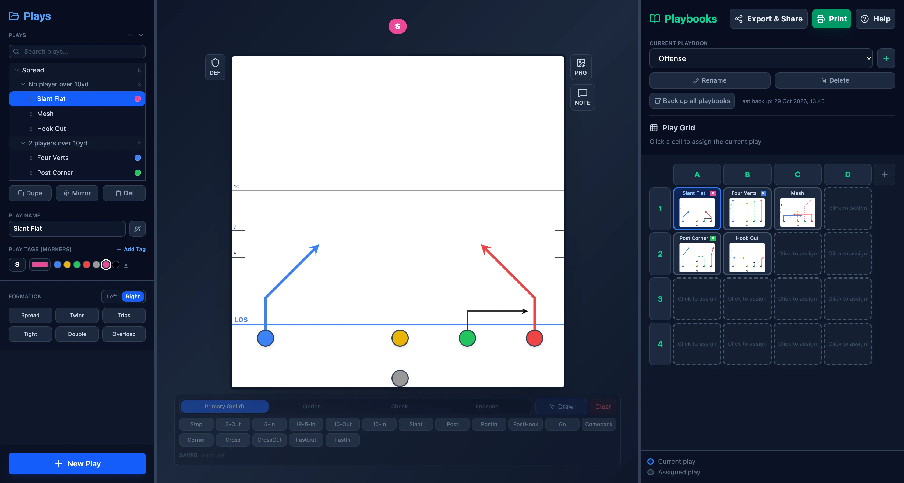
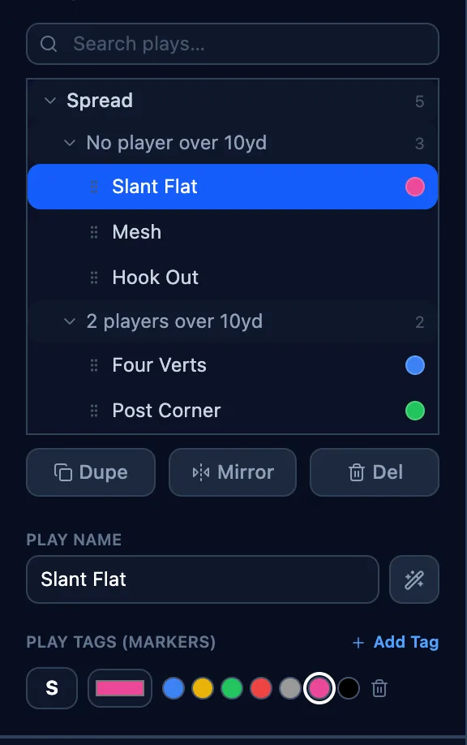
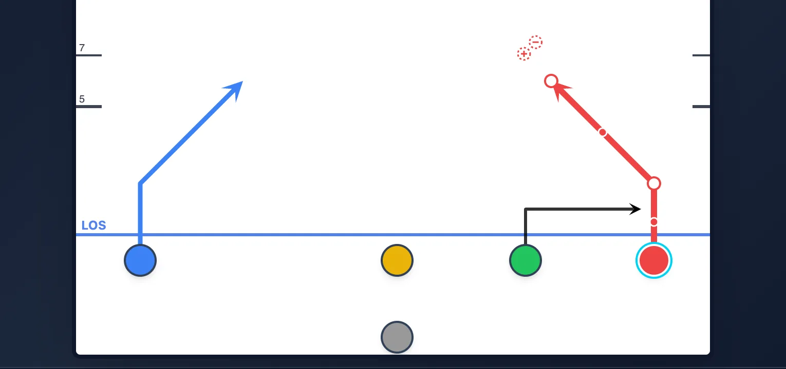
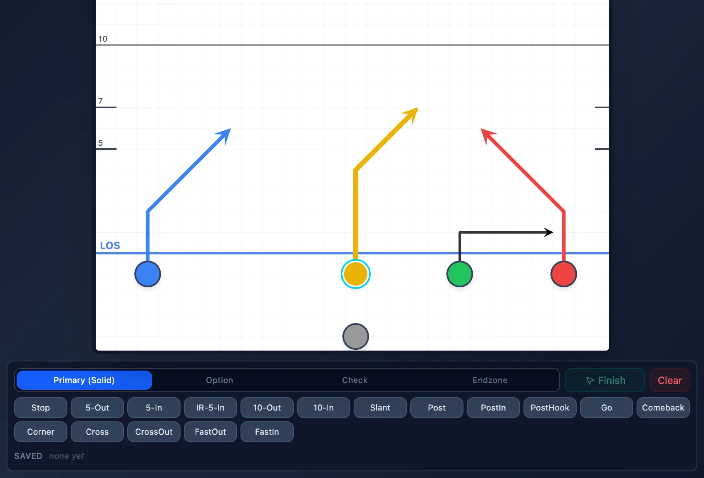
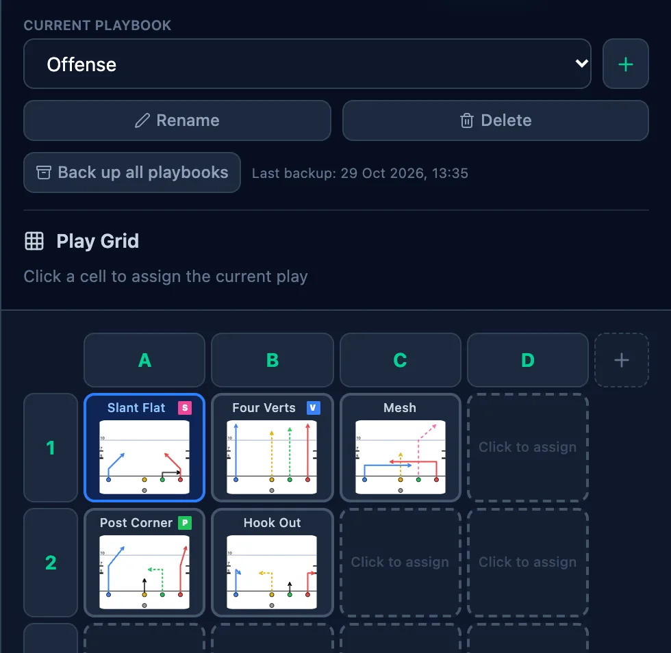
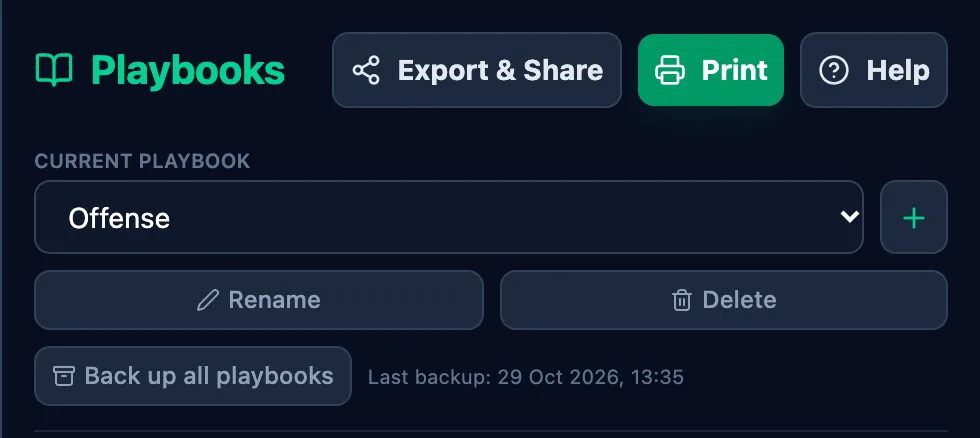

# PlayMakerFlag

**PlayMakerFlag** is a 5v5 flag football playbook maker. Design plays, put them into playbooks, print wristband cards and share them with your team, all in your browser.

**Open it here: https://maierhjakob.github.io/PlayMakeFlag/**



## Features

- **Design plays** on a 25 × 25 yard field, starting from a 5-player formation. Formation buttons (Spread, Twins, Trips, Tight, Double, Overload, left or right), drag players, set labels, colors and motion.
- **Routes**: presets like Slant, Post, Corner or Comeback, or draw your own. Four route types: primary, option, check and endzone. Save your own routes to reuse them, drag the points to adjust, undo/redo with Ctrl/⌘+Z.
- **Organize plays**: plays are grouped into folders by formation and depth, with search, tags, comments, duplicate, mirror and generated play names.
- **Playbooks**: a grid of plays with named columns and 4 rows. One play can be in several playbooks, and changes show up everywhere.
- **Print** wristband cards: 11.5 cm wide, 6.33 cm high by default (adjustable), 1 to 6 per A4 page.
- **Share**: export one or more playbooks as a single HTML file. Opening it imports the playbooks; when a play you already have was changed, you choose which version to keep or keep both. Save a single play as a PNG, with its comment.
- **Backup** of all playbooks in one file. In Chrome and Edge you pick the file once, and later backups overwrite it.
- **Defense view**: see the play from the defense and set up a coverage.
- **Android app** that opens shared playbook files directly.
- **No account, no server**: everything is stored locally in your browser.

## How to use it

The same guide opens in the app on first start and from the **Help** button at the top right.

### 1. Create a play



- Click **New Play** at the bottom of the plays list. It starts with a 5-player formation.
- Give it a name and add **tags** (short markers like a letter or number). They show above the field and in the printed playbook.
- Your plays stay on this device; you don't need an account.

### 2. Set up your players



- **Drag** a player to move them on the field.
- **Click** a player to select them. On the left you can change their label, color, position and add a **motion**.

### 3. Draw routes



- With a player selected, pick the route type: **Primary**, **Option**, **Check** or **Endzone**.
- Click a preset like **Slant** or **Post**, or click **Draw** and click the points on the field.
- Press **Enter** or **Finish** when the route is done, **Esc** to cancel. Drag the points to adjust it later.

### 4. Build your playbook



- On the right (the **Grid** tab on phones), choose a playbook or create a new one with **+**.
- Click an empty cell to put the current play there. Hover a column name and click the pencil to rename it.
- One play can be used in several playbooks; changes show up everywhere.

### 5. Share, print and back up



- **Export & Share** creates a file you can send to your team; opening it imports the playbooks.
- **Print** prints the playbook for a wristband. **PNG** next to the field saves a single play as an image, with its **NOTE**.
- **Back up all playbooks** now and then, so nothing is lost if the browser data is cleared.

## Development

React, TypeScript and Vite, with Tailwind CSS. Runs entirely client-side; data lives in `localStorage`.

```bash
npm install
npm run dev       # dev server at http://localhost:5173/PlayMakeFlag/
npm run build     # type check + production build
npm run lint      # ESLint
```

Deployed to GitHub Pages with the `deploy.yml` workflow (run it manually from the Actions tab or with `gh workflow run deploy.yml`). The Android app is built with Capacitor from the same code.
